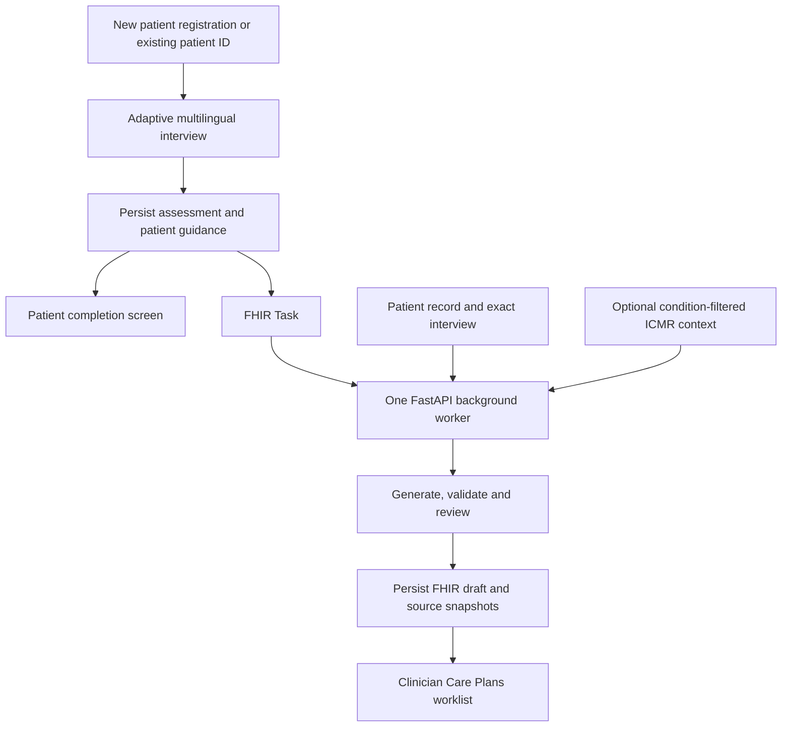

# From patient registration to clinician care-plan draft

New patients register with full name, date of birth and gender, receive a FHIR patient ID, and begin an adaptive interview in their chosen language. Returning patients enter their existing ID. Registration creates a separate record with unrecorded clinical history; it does not copy a demo patient's conditions or infer diagnoses. Stable request identifiers prevent duplicate patient creation when a registration request is retried.

The interview retains adaptive questions, multiple languages, fallback questions, assessment and deterministic safety checks. Its completion screen shows the assessment's immediate guidance. After the assessment is saved, a persisted FHIR Task queues care-plan generation inside the same FastAPI service; care-plan failures do not block the completed patient handoff.

A separate context reader combines demographics, established conditions, medications, allergies, dated observations, the exact completed questionnaire and its linked assessment. Condition names, approved aliases and verified FHIR codes select active ICMR passages from an expandable workflow catalogue. Symptoms in the interview do not become new established diagnoses. Retrieval is separated by condition, bounded to five passages per condition and a whole-passage context budget, with a distinct IRIS care collection that does not alter interview searches.

Default generation uses the LLM's knowledge with ICMR context enrichment. The passages are optional input, not the exclusive basis for recommendations. A structured response and a separate bounded model-review call check patient consistency, applicability, conflicts and prohibited content; deterministic validation checks citation identifiers and recognized prescribing content. One repair is allowed. Model review is a software safeguard, not independent clinical approval. A grounded comparison mode additionally requires applicable source support and excludes the bulk context-only library.

The clinician Care Plans worklist shows interview urgency and generation status. The draft is the primary view, with patient record, exact interview and assessment tabs. Activities cover monitoring, investigations, referrals, lifestyle, follow-up and generic medication review. The assessment's urgent instruction is inserted first and must not be delayed by routine recommendations. Specific drugs/classes/doses, medication changes and new diagnoses are outside the generator's scope. Drafts are read-only, with no editing or approval workflow.

Activity cards show recommendations and proposed timing without inline citation dropdowns or model provenance labels. A separate **Retrieved ICMR context** section displays all stored related passages, including uncited input, with filename, section, line references, document identity and official link. The FHIR metadata still retains activity provenance, selected source IDs, frozen excerpts and versions, model identifier and generation time. Reopening reads that persisted draft without another model call.

The care library consists only of five private user-supplied Markdown files. Python inventories workflows and structural blocks; bounded GPT-6 Luna processing proposed candidate selections. For the current showcase, the user authorized bulk context approval of non-rejected candidates, including supporting and uncertain material. **512 context passages** are indexed; explicit rejections and classifier exclusions remain excluded, and one overlapping hypertension candidate remains blocked. Original classifications, population uncertainty and non-clinical approval labels remain visible in source metadata. Candidate codes are not silently promoted to verified mappings. There is no PDF conversion or upload flow. Old document versions and saved plans are preserved, while new searches exclude the former PDF library.

One worker recovers queued/running Tasks after restart and checks for an already saved CarePlan before invoking generation. Deterministic patient/questionnaire keys avoid duplicate plans; explicit retry handles failed, unqueued and insufficient-evidence cases after their cause is addressed. New CarePlans have `status=draft` and activities `not-started`. Missing applicable ICMR context does not suppress enriched suggestions for an eligible adult, while failed FHIR reads remain failures.

This is a local college demonstration using synthetic data. The private corpus is excluded from Git and Docker build contexts and is not publicly redistributed. User approval, extraction/classification and software tests do not establish clinical correctness or conversion fidelity. [Evaluation results](EVALUATION.md) distinguish protocol tests, limited live model checks, retrieval coverage and unscored clinical measures. See [setup](../README.md), [API](API.md) and [document ingestion](DOCUMENTS.md) for implementation and reproduction details.
